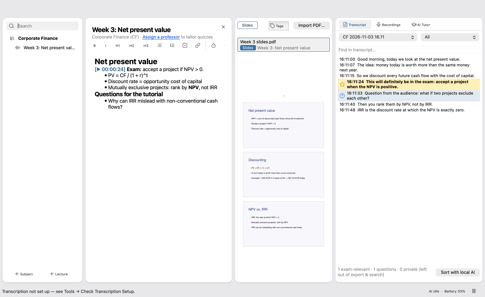
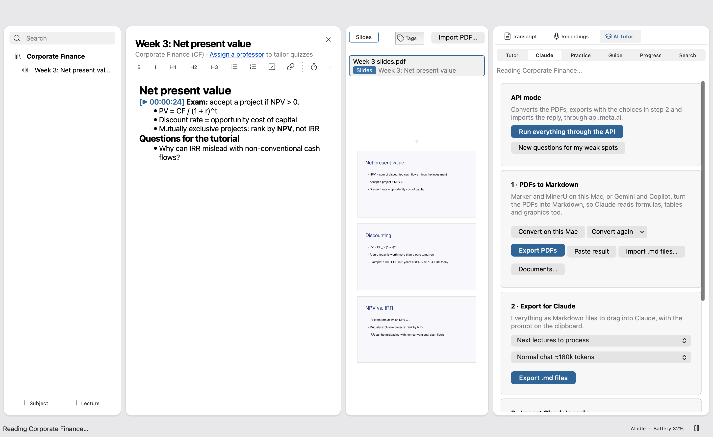
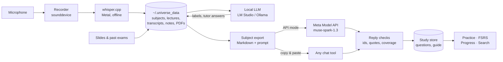

# UniVerse

A local-first study workspace for university courses: record and transcribe lectures, keep slides and notes together, and turn the material into exam practice with Meta's Muse Spark model.


-41CD52)


## Demo

Video: [DEMO_VIDEO_URL]





## The problem

Students sit through lectures, slides, past exams and tutorial sheets, but the material ends up scattered across folders, recordings nobody re-listens to and notes that miss what the professor said would be on the exam. General chatbots can help, but they don't see the course material, they make up sources, and pasting a whole semester into a chat is slow and error-prone.

## What it does

- **Records and transcribes lectures offline** with whisper.cpp on the Mac's GPU, and stars lines like "this will be on the exam".
- **Keeps each lecture in one place:** notes with clickable timestamps into the audio, the slides, and the transcript side by side.
- **Builds exam practice from the course's own material.** The whole subject (slides as Markdown, transcripts, notes) goes to a large model, and the reply comes back as questions, a study guide and exam-relevance labels. Every claim must quote its source page or transcript line, and the app checks those quotes before importing anything.
- **Lets you practise offline** with spaced repetition (FSRS), track progress towards the exam date, and search the whole subject semantically (LanceDB).
- **Includes a local AI tutor** that answers, quizzes or starts from zero, using only passages from the course and citing them.

## How we use Meta's models

UniVerse has an optional **API mode** (off by default) that runs the two heavy steps through one OpenAI-compatible API. The **Meta Model API** is the built-in preset: `https://api.meta.ai/v1` with the model `muse-spark-1.3` ([`universe/services/api_mode.py`](universe/services/api_mode.py), `PRESETS`).

With API mode on, *Run everything through the API* in the Claude tab does two things with Muse Spark:

| Task | What is sent | Code |
|---|---|---|
| **PDF → Markdown** | Slide and exam pages rendered as images, 10 pages per call, with a prompt to rebuild text, formulas and tables as Markdown. Pages a reply skipped get a second pass. | `convert_pdfs`, `_convert_run` in [`api_mode.py`](universe/services/api_mode.py); prompt in [`pdf_conversion.py`](universe/services/pdf_conversion.py) |
| **Study material** | The full subject export (the same Markdown a student would paste into a chat). Muse Spark answers in JSON Lines: questions, guide entries and transcript labels, each with a verbatim source quote. Long replies are continued automatically, then one round each asks for fixes to records that failed the checks and for pages nothing covered. | `exchange`, `_read_reply` in [`api_mode.py`](universe/services/api_mode.py); prompt in [`claude_export.py`](universe/services/claude_export.py); checks in [`claude_reply.py`](universe/services/claude_reply.py) |
| **Weak spots** | *New questions for my weak spots* sends the practice history with the slide pages and transcript excerpts of the weakest topics, and asks for new questions there. | `tutor_questions_prompt` in [`claude_export.py`](universe/services/claude_export.py), called from [`claude_panel.py`](universe/ui/claude_panel.py) |

**Why Meta:** one multimodal model covers both steps (reading page images, then writing long structured output), so the student needs one key instead of a separate chat tool per step. The endpoint is OpenAI-compatible, so the client needs no SDK, just the standard library's `urllib`, and any other OpenAI-compatible provider can be dropped in from the same settings tab.

Whatever comes back goes through the same checks as a pasted reply: unknown ids, quotes that don't appear on the cited page and broken lines are rejected, so a bad answer costs no more than a bad paste. Each run asks before sending, because it sends course material to the provider and costs money. The key is read from `UNIVERSE_API_KEY` or the settings file and is never part of an error message. HTTP redirects are refused so the key can't follow one to another host.

**What does *not* use Meta's models:** transcription (whisper.cpp), transcript sorting and the tutor (a local model via LM Studio or Ollama), and the default copy & paste flow. The optional fine-tuning scaffold in [`modal_training/`](modal_training/) defaults to Qwen2.5 and accepts any Hugging Face base model, including Llama, via `--base-model`.

### How Muse Code was used to build it

Parts of the code work ran through Muse Code: Claude Code running on `muse-spark-1.3` through the Meta Model API. It did first-pass code reviews and test-first fixes from written briefs, with only file tools and the test runner allowed. Every diff it produced was reviewed and the test suite run before committing. It never saw real student data.

## Architecture



UniVerse is a PySide6 desktop app ([`universe/ui/`](universe/ui/)) on top of plain Python services ([`universe/services/`](universe/services/)) that the UI calls from background jobs. All data lives in files under `~/.universe_data`, one folder per subject and lecture, so nothing needs a database server. A subject is read into a single view model ([`subject_model.py`](universe/services/subject_model.py)) that feeds the export, the checks and the practice tabs. The large model sits behind one boundary: the export goes out, and the reply only gets in through [`claude_reply.py`](universe/services/claude_reply.py)'s checks, whether it came from the Meta API or a pasted chat.

## Getting started

**Prerequisites:** macOS on Apple Silicon, Python 3.11 or newer, [Homebrew](https://brew.sh) (only for transcription). macOS ships Python 3.9, so install a newer one if `python3 --version` is older (`brew install python@3.13`).

```bash
git clone https://github.com/marcfischer026/StudyHub.git
```

```bash
cd StudyHub
```

```bash
python3 -m venv .venv
```

```bash
.venv/bin/pip install -r requirements.txt
```

```bash
.venv/bin/python -m universe
```

The app opens with an empty workspace. Create a subject and a lecture, import a PDF, and the Claude tab is ready.

**Use Muse Spark (API mode):** open *Settings → API* (`⌘,`), turn on API mode, and pick the **Meta Model API** preset. Paste the key there, or keep it out of the settings file and pass it in the environment:

```bash
cp .env.example .env
```

Put the key into `UNIVERSE_API_KEY` in `.env`, then start the app with it loaded:

```bash
set -a && source .env && set +a && .venv/bin/python -m universe
```

**Environment variables** (see [`.env.example`](.env.example)):

| Variable | Needed for |
|---|---|
| `UNIVERSE_API_KEY` | API mode; wins over the key in settings |
| `UNIVERSE_DATA_DIR` | a different data folder, e.g. a throwaway one for testing (default `~/.universe_data`) |
| `HF_TOKEN` | only `modal_training/`, for gated base models |

**Optional, for recording:** offline transcription needs whisper.cpp and a model (~550 MB):

```bash
brew install whisper-cpp
```

```bash
mkdir -p ~/.universe_data/models && curl -L -o ~/.universe_data/models/ggml-large-v3-turbo-q5_0.bin https://huggingface.co/ggerganov/whisper.cpp/resolve/main/ggml-large-v3-turbo-q5_0.bin
```

**Tests and lint:**

```bash
QT_QPA_PLATFORM=offscreen UNIVERSE_DATA_DIR="$(mktemp -d)" .venv/bin/python -m unittest discover -s tests
```

```bash
pipx run ruff check .
```

The full feature guide (keyboard shortcuts, local PDF conversion, the local AI sorting, speaker recognition, data layout, troubleshooting) is in [`docs/USER_GUIDE.md`](docs/USER_GUIDE.md).

## Tech stack

- **App:** Python 3.11+, PySide6 (Qt 6), PyObjC for native macOS chrome
- **AI:** Meta Model API (`muse-spark-1.3`) in API mode; whisper.cpp for speech-to-text; any OpenAI-compatible local server (LM Studio, Ollama, `mlx_lm`) for sorting and the tutor
- **Documents:** PyMuPDF; optional Marker and MinerU for on-device PDF conversion
- **Search:** LanceDB with an offline hashing embedder (sentence-transformers optional)
- **Practice:** FSRS spaced repetition, implemented in [`fsrs.py`](universe/services/fsrs.py)
- **Audio:** sounddevice, pygame-ce
- **Optional training:** Modal + PEFT LoRA ([`modal_training/`](modal_training/))

## Hackathon context

Built for the **Meta Global AI Hackathon**.

- **Track:** [TRACK]
- **Problem statement:** [PROBLEM_STATEMENT]
- **Team:** [TEAM]

## What's next and limitations

- **macOS on Apple Silicon only.** Recording, whisper.cpp with Metal and the native window chrome are Mac-specific; the UI has a platform layer so Windows could follow.
- **API mode is covered by tests against a fake server** ([`tests/test_api_mode.py`](tests/test_api_mode.py)), not live calls. How well Muse Spark handles very long subjects or dense formula pages still needs more real runs.
- **API mode sends course material to the provider.** It asks before every run, but students should check what their university allows.
- **The tutor and transcript sorting need a local model server** running; without one, those features say so and stay off.
- **Fine-tuning is a scaffold**, not part of the main flow.
- Next: run the tutor through the Meta Model API as well for machines without a local model, and a podcast-style audio summary per lecture.

## License

[MIT](LICENSE). The bundled Lucide icons are under the [ISC license](universe/ui/assets/icons/LICENSE).
